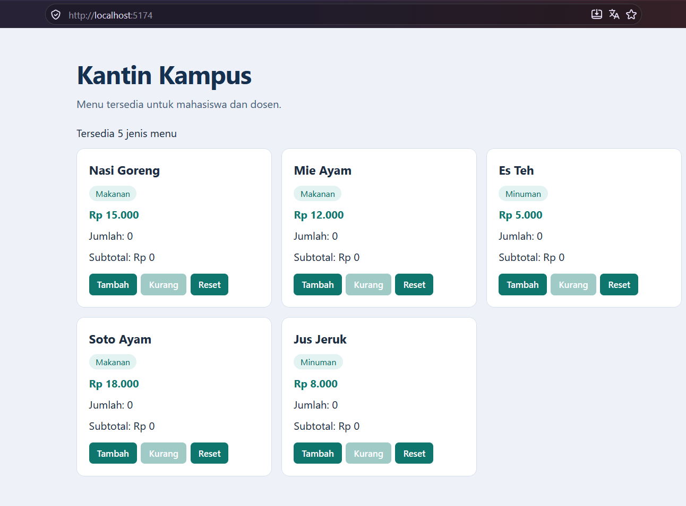
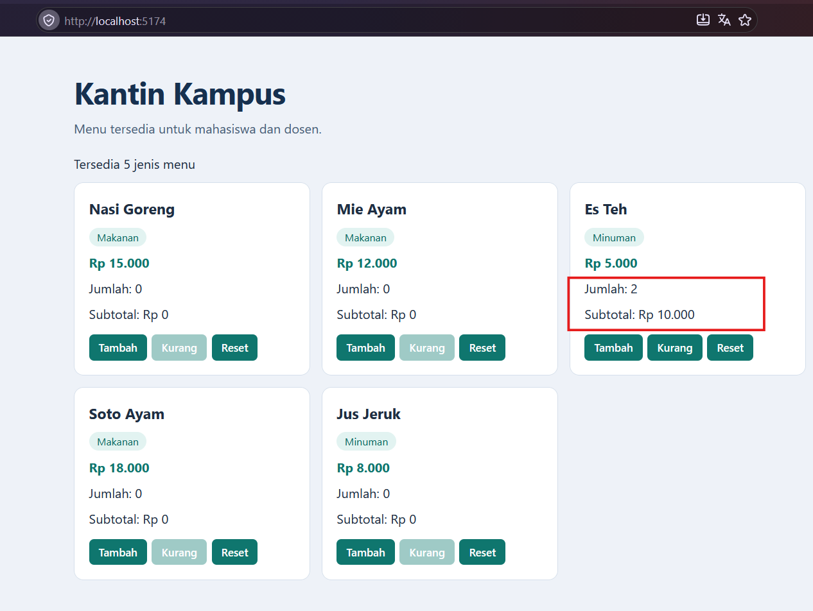
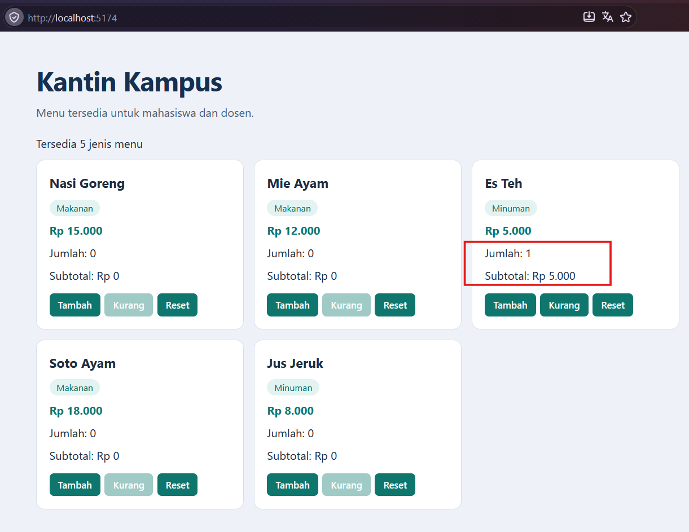
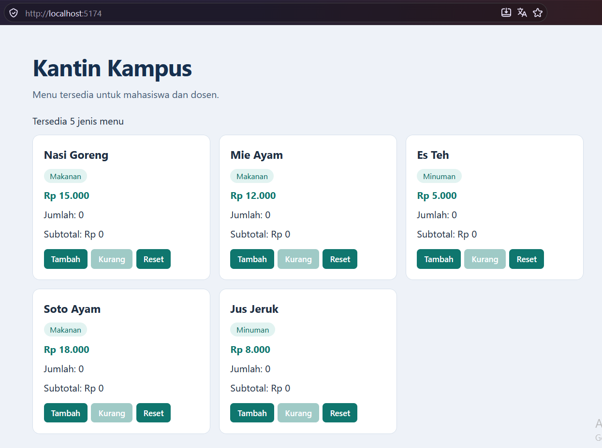

# Kantin Kampus (React + TypeScript + Vite)

| | |
| --- | --- |
| Nama | Muhamad Sabilil Haq |
| NRP | 5027251041 |
| Mata kuliah | Pemrograman Web |

Halaman pemesanan menu kantin. Setiap kartu menu punya tombol Tambah, Kurang, dan Reset, dan subtotalnya langsung berubah.

## Cara menjalankan

```bash
npm install
npm run dev
```

Buka URL Local yang muncul di terminal (http://localhost:xxxx).

## Struktur file

```
kantin-kampus/
├── index.html          elemen #root
├── package.json
├── vite.config.ts
└── src/
    ├── main.tsx        titik masuk React
    ├── App.tsx         array menu + state jumlah (useState)
    ├── MenuCard.tsx    komponen kartu yang dipakai berulang (menerima props)
    └── index.css       gaya tampilan
```

## Penjelasan: bagaimana tombol mengubah state dan subtotal

Saat tombol **Tambah** pada kartu Es Teh diklik, `MenuCard` memanggil prop `onTambah(3)`, yaitu fungsi `tambah` di `App` yang menjalankan `setJumlah` untuk menaikkan jumlah menu ber-ID 3 sebanyak satu tanpa mengubah jumlah menu lain. Setelah state berubah, React merender ulang `App`, sehingga kartu Es Teh menerima prop `jumlah` yang baru. Kartu lalu menghitung `subtotal = harga × jumlah`, jadi subtotal langsung berubah, misalnya dari Rp 5.000 menjadi Rp 10.000.

## Contoh pengujian

- Tekan Tambah dua kali pada Es Teh → Jumlah 2, Subtotal Rp 10.000.
- Tekan Kurang sekali → Rp 5.000.
- Tekan Reset → Rp 0 (tombol Kurang nonaktif lagi).

## Hasil pengujian








